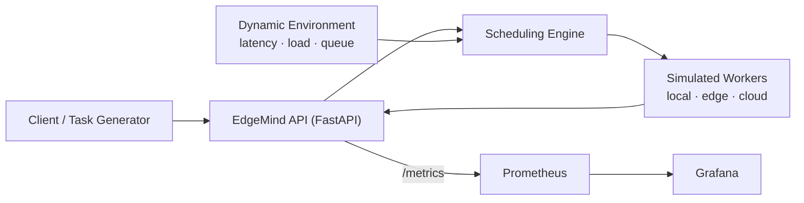

# EdgeMind — Intelligent Edge–Cloud Workload Orchestrator

*An Intelligent Edge–Cloud Workload Orchestrator for Latency-Aware and
Resource-Efficient Task Offloading.*

EdgeMind decides whether a computational task should run on the **local
device**, an **edge server**, or a **cloud server**, based on network
latency, compute requirements, server load, queue length, and the task's
latency deadline — then validates its scheduling policies with
reproducible, statistically analyzed experiments.

## Research question

> When network latency and server load vary, can adaptive task
> scheduling reduce task completion latency compared to a static
> rule-based policy?

**Finding (simulation, held-out seeds 100–109, tuned policy, paired
comparison, queue-aware execution):** the adaptive policy cuts the
**deadline-miss rate from 27.3% to 2.3%** (~11.7× fewer misses among
executed tasks) and raises **overall on-time completion from 57.8% to
69.4%** (+11.6 pp, bootstrap 95% CI excludes zero), while also being
**~32 ms faster on average** — the queue-blind baseline pays real queue
wait it cannot see. The remaining trade-off: adaptive rejects ~10 pp
more tasks up front (honest admission when deadlines are infeasible),
so baseline finishes more tasks overall — but many of them late.
Full details, ablation, scenario analysis, and the two model fixes that
preceded these numbers: [docs/evaluation.md](docs/evaluation.md).

## Live results dashboard

A public dashboard presents the simulation and real-worker results with
their confidence intervals and limitations:

- **Hosted demo:** see the link at the top of this section once deployed
  (Streamlit Community Cloud; app entry point `dashboard/app.py`).
- Run locally: `pip install -r dashboard/requirements.txt && streamlit run dashboard/app.py`

The dashboard reads only committed aggregate tables
(`dashboard/data/`, exported by `benchmarks/export_dashboard_data.py`) —
never raw experiment files.

## Architecture



Execution nodes can be **simulated** (fast, fully reproducible) or
**real containerized workers** (`compose.real.yaml`: three CPU-limited
Docker services executing measured CPU-bound work — see
[docs/real_worker_experiment.md](docs/real_worker_experiment.md)).
The design keeps execution behind interfaces so either backend plugs
into the same schedulers. See [docs/architecture.md](docs/architecture.md).

## Quick start

```sh
python -m venv .venv && source .venv/bin/activate
pip install -r requirements.txt

uvicorn app.main:app --reload
# → http://127.0.0.1:8000/docs  (interactive API)
# → http://127.0.0.1:8000/health
```

Or with Docker (API + Prometheus + Grafana):

```sh
docker compose up -d
# API:        http://localhost:8000
# Prometheus: http://localhost:9090
# Grafana:    http://localhost:3000  (admin / admin)
```

## API

| Method | Endpoint | Description |
| --- | --- | --- |
| GET | `/health` | Liveness check |
| POST | `/schedule?policy=baseline\|adaptive` | Select a target without executing |
| POST | `/execute?policy=baseline\|adaptive` | Schedule and simulate execution |
| GET | `/metrics` | Prometheus metrics |

Example:

```sh
curl -X POST "http://127.0.0.1:8000/execute?policy=adaptive" \
  -H "Content-Type: application/json" \
  -d '{"task_id": "demo-1", "compute_units": 100, "max_latency_ms": 500}'
```

```json
{
  "task_id": "demo-1",
  "target": "local",
  "success": true,
  "network_latency_ms": 0.0,
  "compute_duration_ms": 10.75,
  "total_latency_ms": 10.75,
  "deadline_met": true
}
```

## Scheduling algorithms

- **Baseline** — among nodes whose *static* estimated latency meets the
  deadline, pick the fastest. Ignores current load and queue.
- **Adaptive** — among *feasible* nodes, minimize an interpretable
  weighted cost: estimated latency (including queue wait) + load
  overload penalty + failure-risk penalty. Weights `w_load = 0`,
  `w_failure = 200` (latency-equivalent ms), tuned by grid search on
  dedicated tuning seeds with an admission-aware objective and reported
  on held-out seeds. The load penalty defaults to 0 because load is
  already priced into the latency estimate; the term remains for
  future use.
- Rejected tasks (no feasible node) return HTTP 422 and are counted as
  scheduling failures.

Latency model: `network_latency + compute_units / compute_rate *
(1 + queue_length)`; simulated execution applies the same model
(`network + queue wait + compute`), so estimates and execution stay
consistent.

## Tests

```sh
pytest -q    # 30 tests
```

## Benchmarks and evaluation

```sh
# Single-run benchmark
python -m benchmarks.run_benchmark
python -m benchmarks.analyze_results results/raw/benchmark_seed42.csv

# Full research evaluation (held-out seeds, paired runs, ablations)
python -m benchmarks.tune_weights
python -m benchmarks.run_evaluation --first-seed 100 --out results/raw/evaluation_heldout.csv
python -m benchmarks.analyze_evaluation results/raw/evaluation_heldout.csv

# Scenario benchmarks (workload intensity, network regimes)
python -m benchmarks.run_scenarios
python -m benchmarks.analyze_scenarios results/raw/scenarios.csv
```

Protocol and fairness rules: [docs/experiment_protocol.md](docs/experiment_protocol.md).

## Repository layout

```
app/          FastAPI app, models, scheduler, workers, monitoring
benchmarks/   experiment runners and analysis scripts
docs/         architecture, methodology, experiment protocol, evaluation
monitoring/   Prometheus and Grafana configuration
results/      experiment outputs (gitignored)
tests/        pytest suite
```

## Limitations and future work

- Nodes are simulated with stylised parameters; all latency, queue, and
  execution results are simulated, not measured on physical edge/cloud
  infrastructure. Real/containerized workers are a planned next step.
- Aggregate improvements do not hold in every seed (per-seed
  heterogeneity exists; see `docs/evaluation.md`), and seed-level
  bootstrap CIs at n = 10 are approximate.
- Adaptive rejects ~10 pp more tasks than baseline; workloads that
  cannot reject need a retry/defer mechanism (future work).
- Adaptive weights are hand-tuned by grid search on 10 tuning seeds;
  ablation isolates each term's contribution.
- Throughput, resource utilization, and scheduling overhead are not
  instrumented; timeouts are not a separate outcome category.
- Learning-based policies (RL) are future work; the interpretable
  heuristic is the intentional first step.

## Documentation

- [Architecture](docs/architecture.md)
- [Methodology](docs/methodology.md)
- [Experiment protocol](docs/experiment_protocol.md)
- [Evaluation results](docs/evaluation.md)
