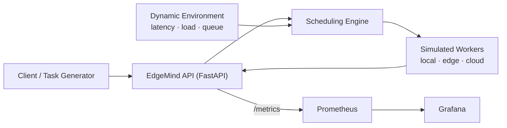

# EdgeMind — Intelligent Edge–Cloud Workload Orchestrator

*An Intelligent Edge–Cloud Workload Orchestrator for Latency-Aware and
Resource-Efficient Task Offloading.*

EdgeMind decides whether a computational task should run on the **local
device**, an **edge server**, or a **cloud server**, based on network
latency, compute requirements, server load, queue length, and the task's
latency deadline — then validates its scheduling policies with
reproducible, statistically analyzed experiments.

## Research question

> When network latency and server load vary, can adaptive task
> scheduling reduce task completion latency compared to a static
> rule-based policy?

**Finding (simulation, 10 seeds × 300 tasks, paired comparison):**
the adaptive policy cuts the **deadline-miss rate from 7.0% to 2.1%**
(bootstrap 95% CI of the paired difference excludes zero), at the cost
of **~10 ms higher mean latency**. Deadline adherence and average
latency genuinely trade off; adaptive scheduling wins where deadlines
matter. Full details, ablation results, and limitations:
[docs/evaluation.md](docs/evaluation.md).

## Architecture



All execution nodes are **simulated** in this version; the design keeps
them behind interfaces so real or containerized workers can replace
them later. See [docs/architecture.md](docs/architecture.md).

## Quick start

```sh
python -m venv .venv && source .venv/bin/activate
pip install -r requirements.txt

uvicorn app.main:app --reload
# → http://127.0.0.1:8000/docs  (interactive API)
# → http://127.0.0.1:8000/health
```

Or with Docker (API + Prometheus + Grafana):

```sh
docker compose up -d
# API:        http://localhost:8000
# Prometheus: http://localhost:9090
# Grafana:    http://localhost:3000  (admin / admin)
```

## API

| Method | Endpoint | Description |
| --- | --- | --- |
| GET | `/health` | Liveness check |
| POST | `/schedule?policy=baseline\|adaptive` | Select a target without executing |
| POST | `/execute?policy=baseline\|adaptive` | Schedule and simulate execution |
| GET | `/metrics` | Prometheus metrics |

Example:

```sh
curl -X POST "http://127.0.0.1:8000/execute?policy=adaptive" \
  -H "Content-Type: application/json" \
  -d '{"task_id": "demo-1", "compute_units": 100, "max_latency_ms": 500}'
```

```json
{
  "task_id": "demo-1",
  "target": "local",
  "success": true,
  "network_latency_ms": 0.0,
  "compute_duration_ms": 10.75,
  "total_latency_ms": 10.75,
  "deadline_met": true
}
```

## Scheduling algorithms

- **Baseline** — among nodes whose *static* estimated latency meets the
  deadline, pick the fastest. Ignores current load and queue.
- **Adaptive** — among *feasible* nodes, minimize an interpretable
  weighted cost: estimated latency (including queue wait) + load
  overload penalty + failure-risk penalty. Defaults: `w_load = 10`,
  `w_failure = 1000` (latency-equivalent ms).
- Rejected tasks (no feasible node) return HTTP 422 and are counted as
  scheduling failures.

Latency model: `network_latency + compute_units / compute_rate *
(1 + queue_length)`.

## Tests

```sh
pytest -q    # 30 tests
```

## Benchmarks and evaluation

```sh
# Single-run benchmark
python -m benchmarks.run_benchmark
python -m benchmarks.analyze_results results/raw/benchmark_seed42.csv

# Full research evaluation (10 seeds, paired runs, ablations)
python -m benchmarks.run_evaluation --tasks 300 --seeds 10
python -m benchmarks.analyze_evaluation results/raw/evaluation.csv
```

Protocol and fairness rules: [docs/experiment_protocol.md](docs/experiment_protocol.md).

## Repository layout

```
app/          FastAPI app, models, scheduler, workers, monitoring
benchmarks/   experiment runners and analysis scripts
docs/         architecture, methodology, experiment protocol, evaluation
monitoring/   Prometheus and Grafana configuration
results/      experiment outputs (gitignored)
tests/        pytest suite
```

## Limitations and future work

- Nodes are simulated with stylised parameters; no physical-network
  measurements. Real/containerized workers are a planned next step.
- Adaptive weights are hand-chosen; ablation shows tuning (especially
  the failure penalty) would improve results.
- Learning-based policies (RL) are future work; the interpretable
  heuristic is the intentional first step.
- 10 evaluation seeds give modest statistical power.

## Documentation

- [Architecture](docs/architecture.md)
- [Methodology](docs/methodology.md)
- [Experiment protocol](docs/experiment_protocol.md)
- [Evaluation results](docs/evaluation.md)
