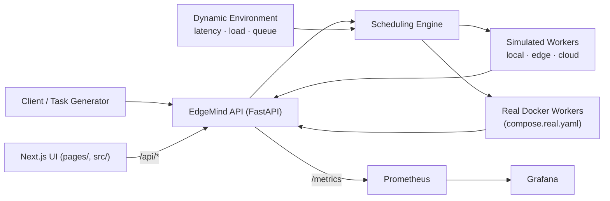

# EdgeMind — Intelligent Edge–Cloud Workload Orchestrator

**Latency-aware, resource-efficient task offloading across local, edge, and cloud execution — with a reproducible, statistically validated evaluation pipeline and a live interactive demo.**


---

## Overview

EdgeMind decides whether a computational task should run on the **local
device**, an **edge server**, or a **cloud server**, based on network
latency, compute requirements, server load, queue length, and the task's
deadline — then validates its scheduling policies with reproducible,
statistically analyzed experiments on both **simulated** nodes and
**real containerized workers**.

> **Research question:** When network latency and server load vary, can
> adaptive task scheduling reduce task completion latency compared to a
> static rule-based policy?

## Key results

**Simulation** — held-out seeds 100–109, paired comparison, tuned policy:

| Metric | Baseline | Adaptive | Δ |
| --- | ---: | ---: | ---: |
| Deadline-miss rate (executed tasks) | 27.3% | 2.3% | **~11.7× fewer misses** |
| Overall on-time completion | 57.8% | 69.4% | **+11.6 pp** (bootstrap 95% CI excludes 0) |
| Mean latency | — | — | **~32 ms faster** |

Trade-off, reported honestly: adaptive rejects ~10 pp more tasks up
front (it declines work whose deadlines are infeasible), so the baseline
finishes more tasks overall — but many of them late.

**Real Docker workers** — 20 paired runs × 4 policies, CPU-limited
containers, run-level paired bootstrap:

| Comparison | Overall on-time Δ | Interpretation |
| --- | ---: | --- |
| C − A (adaptive − original baseline) | +1.2 pp [−0.7, +3.1] | Null overall |
| B − A (calibration only) | −6.9 pp [−8.4, −5.5] | Calibration alone *hurts* — it concentrates load on the cloud |
| C − B (queue awareness) | **+8.1 pp** [+6.4, +9.6] | **Queue awareness is the active ingredient** |

Full analysis, ablations, and limitations:
[docs/evaluation.md](docs/evaluation.md) ·
[docs/real_worker_experiment.md](docs/real_worker_experiment.md)

## Live demos

- **Interactive app (Next.js + FastAPI):** five pages — overview, live
  node monitor, task scheduler (submit a task and watch both policies
  decide), research analytics, and an experiment control panel that runs
  paired benchmarks on demand. Deploys to Vercel as **one project**
  (see below).
- **Results dashboard (Streamlit):**
  [edge-cloud-scheduler.streamlit.app](https://edge-cloud-scheduler.streamlit.app) —
  simulation and real-worker aggregates with confidence intervals.
  Entry point `dashboard/app.py`; reads only committed aggregate tables
  (`dashboard/data/`), never raw experiment files.

## Architecture



Execution sits behind an interface, so **simulated** nodes (fast, fully
reproducible) and **real containerized workers** (three CPU-limited
Docker services executing measured CPU-bound work) plug into the same
schedulers. See [docs/architecture.md](docs/architecture.md).

## Scheduling policies

- **Baseline** — among nodes whose *static* estimated latency meets the
  deadline, pick the fastest. Ignores current load and queue.
- **Adaptive** — among *feasible* nodes, minimize an interpretable
  weighted cost: estimated latency (including queue wait) + load
  overload penalty + failure-risk penalty. Weights tuned by grid search
  on dedicated tuning seeds, reported on held-out seeds.
- Tasks with no feasible node are rejected (HTTP 422) and counted as
  scheduling failures — never silently dropped from the metrics.

Latency model: `network_latency + compute_units / compute_rate × (1 + queue_length)`.
Simulated execution applies the same model, so estimates and execution
stay consistent.

## Quick start

**API (Python):**

```sh
python -m venv .venv && source .venv/bin/activate
pip install -r requirements.txt
uvicorn app.main:app --reload
# → http://127.0.0.1:8000/docs   (interactive API)
```

**Interactive UI (Next.js):**

```sh
npm install
uvicorn app.main:app --port 8000 &   # API
npm run dev                          # UI → http://localhost:3000
```

In development, `next.config.mjs` proxies `/api/*` to the local FastAPI
server — same origin, no CORS.

**Deploy to Vercel (one project):** import this repository, keep the
default **Next.js** preset, deploy. Vercel builds the UI and serves
`/api/*` from the Python serverless function in `api/index.py`
(dependencies from `requirements.txt`).

**Full stack with Docker (API + Prometheus + Grafana):**

```sh
docker compose up -d
# API: http://localhost:8000 · Prometheus: :9090 · Grafana: :3000 (admin/admin)
```

## API

| Method | Endpoint | Description |
| --- | --- | --- |
| GET | `/health` | Liveness check |
| GET | `/state` | Current node state (rate, load, queue, network) |
| POST | `/schedule?policy=baseline\|adaptive` | Select a target without executing |
| POST | `/execute?policy=baseline\|adaptive` | Schedule and simulate execution |
| POST | `/benchmark?tasks=N&seed=S` | Paired mini-benchmark, deterministic per seed |
| GET | `/metrics` | Prometheus metrics |

```sh
curl -X POST "http://127.0.0.1:8000/execute?policy=adaptive" \
  -H "Content-Type: application/json" \
  -d '{"task_id": "demo-1", "compute_units": 100, "max_latency_ms": 500}'
```

```json
{
  "task_id": "demo-1",
  "target": "local",
  "success": true,
  "network_latency_ms": 0.0,
  "compute_duration_ms": 10.75,
  "total_latency_ms": 10.75,
  "deadline_met": true
}
```

## Reproducing the evaluation

```sh
# Single-run benchmark
python -m benchmarks.run_benchmark
python -m benchmarks.analyze_results results/raw/benchmark_seed42.csv

# Full research evaluation (held-out seeds, paired runs, ablations)
python -m benchmarks.tune_weights
python -m benchmarks.run_evaluation --first-seed 100 --out results/raw/evaluation_heldout.csv
python -m benchmarks.analyze_evaluation results/raw/evaluation_heldout.csv

# Scenario benchmarks (workload intensity, network regimes)
python -m benchmarks.run_scenarios
python -m benchmarks.analyze_scenarios results/raw/scenarios.csv
```

Protocol and fairness rules: [docs/experiment_protocol.md](docs/experiment_protocol.md).

## Testing

```sh
pytest -q    # 60 tests
```

## Repository layout

```
app/          FastAPI app, models, scheduler, workers, monitoring
api/          Vercel serverless entry point (strips /api prefix)
benchmarks/   experiment runners and analysis scripts
dashboard/    Streamlit results dashboard + committed aggregates
docs/         architecture, methodology, protocol, evaluation, real-worker study
monitoring/   Prometheus and Grafana configuration
pages/ src/   Next.js interactive demo (pages router, components, lib)
public/       static assets and committed aggregate CSVs for the UI
tests/        pytest suite
```

## Limitations

- Simulated nodes use stylised parameters; simulation latencies are not
  physical measurements. The real-worker testbed validates which
  findings survive wall-clock execution — and shows the headline
  simulation gap shrinks substantially (see
  [docs/real_worker_experiment.md](docs/real_worker_experiment.md)).
- Local Docker measurements do **not** represent a geographically
  distributed edge–cloud deployment.
- Per-seed heterogeneity exists; small-sample bootstrap CIs are
  approximate. Rejected, failed, late, and on-time tasks are always
  reported separately.
- Throughput, utilization, and scheduling overhead are not instrumented;
  learning-based (RL) policies are future work — the interpretable
  heuristic is the intentional first step.

## Documentation

- [Architecture](docs/architecture.md)
- [Methodology](docs/methodology.md)
- [Experiment protocol](docs/experiment_protocol.md)
- [Evaluation results](docs/evaluation.md)
- [Real-worker experiment](docs/real_worker_experiment.md)
- [Project summary](docs/project_summary.md)
