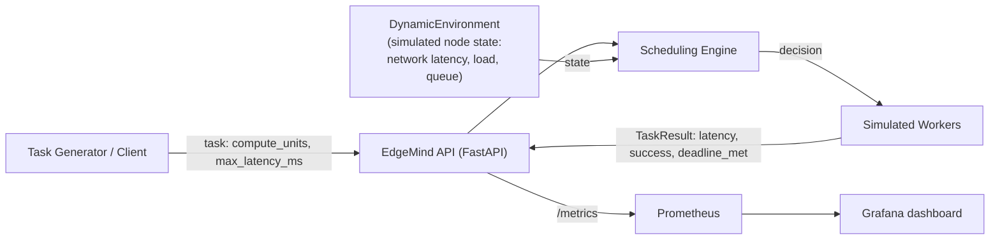

# EdgeMind — Architecture

EdgeMind decides where a computational task should run — **local
device**, **edge server**, or **cloud server** — based on task
properties and current network/node conditions.

## System overview

## Components

| Component | Location | Responsibility |
| --- | --- | --- |
| API | `app/main.py` | `/health`, `/schedule`, `/execute`, `/metrics`; request validation via Pydantic models |
| Task model | `app/models/task.py` | `TaskRequest` (compute units, latency budget) and `TaskResult` (outcome, deadline met) |
| Node profiles | `app/scheduler/nodes.py` | Static capacity assumptions for local / edge / cloud |
| Latency model | `app/scheduler/latency.py` | `network_latency + service_time * (1 + queue_length)` |
| Baseline policy | `app/scheduler/baseline.py` | Fastest *statically* feasible node |
| Adaptive policy | `app/scheduler/adaptive.py` | Lowest weighted cost: latency + load penalty + failure-risk penalty |
| Dynamic environment | `app/scheduler/environment.py` | Mean-reverting evolution of latency, load, and queue per node |
| Workers | `app/workers/simulated_worker.py` | Simulated execution with jitter and load-dependent failure |
| Monitoring | `app/monitoring/metrics.py` | Prometheus counters and histograms for scheduling and execution |
| Benchmarks | `benchmarks/` | Reproducible experiment runners and analysis (pandas/matplotlib) |

## Execution nodes (simulated)

| Node | Network latency | Compute rate | Rationale |
| --- | --- | --- | --- |
| local | 0 ms | 10 units/ms | No network, slow compute |
| edge | 8 ms | 30 units/ms | Close, moderate compute |
| cloud | 35 ms | 100 units/ms | Far, fast compute |

These are **development assumptions for simulation**, not measurements
of physical hardware. The design keeps node access behind an interface
(`NodeProfile` / `NodeState`) so real or containerized workers can
replace the simulator later.

## Task lifecycle

1. Client submits a task with `compute_units` and `max_latency_ms`.
2. The API validates the request and asks the scheduling engine for a
   target (`policy=baseline` or `policy=adaptive`).
3. The adaptive policy first advances the dynamic environment
   (`ENV.tick()`), then scores feasible nodes by weighted cost.
4. If no node is feasible, the API returns HTTP 422 and records a
   scheduling-failure metric.
5. `/execute` additionally runs the task on a simulated worker and
   returns the full `TaskResult`; latency and outcome metrics are
   recorded for Prometheus.

## Deployment

Docker Compose runs three services: `api` (FastAPI + uvicorn),
`prometheus` (scrapes `api:8000/metrics`), and `grafana` (pre-provisioned
Prometheus datasource). See the README for commands.
